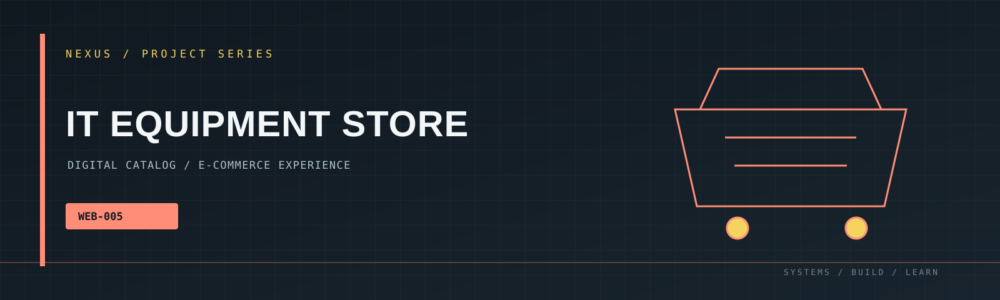

# IT Equipment E-commerce Website

<div align="center">



</div>

A web-based e-commerce project focused on the sale of computer and IT equipment.

## Overview

The repository contains a project for an online IT equipment store. The README is intentionally limited to the confirmed project description until the source structure and implemented features are reviewed.

## Project goals

- Present IT equipment in an online catalog.
- Explore the structure of an e-commerce website.
- Practice web application development and project organization.

## Technologies

The exact frameworks, languages, database and runtime requirements should be documented from the repository's source files rather than assumed.

## Getting started

Clone the repository:

```bash
git clone https://github.com/HoussamEssaki/Vente-de-Mat-riel-Informatique.git
cd Vente-de-Mat-riel-Informatique
```

Consult the project files for the relevant installation and execution instructions.

## Documentation to add

- Verified technology stack and prerequisites.
- Screenshots of the actual website.
- Main implemented user journeys.
- Database and application architecture, if applicable.
- Installation and configuration steps.
- Testing instructions and known limitations.

---

**Academic web development project — E-commerce.**
